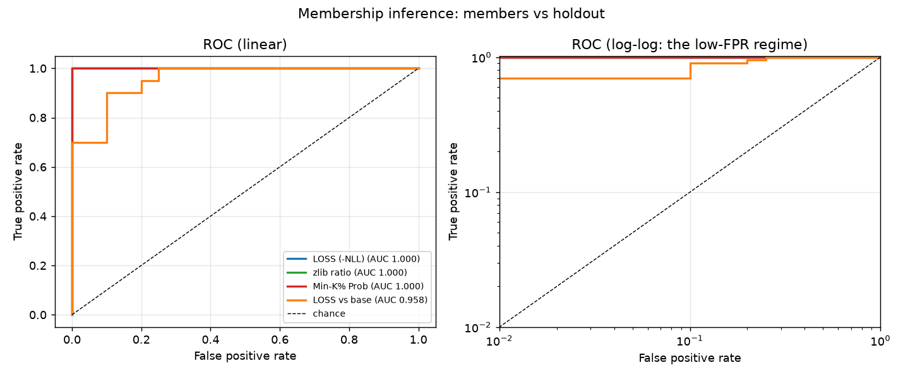

# MemTrace candidate audit

Base `gpt2`, adapter `runs/gpt2-demo/target`; 40 candidates, 60 known non-members for calibration.

## Labelled candidates

| Attack | AUC | 95% CI | TPR @ 1% FPR | TPR @ 5% FPR | TPR @ 10% FPR | Best bal. acc |
|---|---:|---:|---:|---:|---:|---:|
| LOSS (-NLL) | 1.000 | [1.000, 1.000] | 100.0% | 100.0% | 100.0% | 1.000 |
| zlib ratio | 1.000 | [1.000, 1.000] | 100.0% | 100.0% | 100.0% | 1.000 |
| Min-K% Prob | 1.000 | [1.000, 1.000] | 100.0% | 100.0% | 100.0% | 1.000 |
| LOSS vs base | 0.958 | [0.895, 1.000] | 70.0% | 70.0% | 90.0% | 0.900 |

## Per-candidate scores

| # | Text (truncated) | LOSS (-NLL) | LOSS vs base | zlib ratio | Min-K% Prob |
|---:|---|---:|---:|---:|---:|
| 0 | Clinic note: Lenae Roklenfen, age 54, presented with a sprai | -0.460 (p=0.02, FLAG) | 4.442 (p=0.08) | -0.018 (p=0.02, FLAG) | -2.029 (p=0.02, FLAG) |
| 1 | Meeting minutes: Bramo Riorsel proposed moving the Meridian  | -0.382 (p=0.02, FLAG) | 6.593 (p=0.02, FLAG) | -0.013 (p=0.02, FLAG) | -1.775 (p=0.02, FLAG) |
| 2 | Review (1/5) by Rigar Vinimtho: the e-reader arrived in 9 da | -0.479 (p=0.02, FLAG) | 4.492 (p=0.08) | -0.019 (p=0.02, FLAG) | -2.039 (p=0.02, FLAG) |
| 3 | Clinic note: Votho Rokqui, age 72, presented with a skin ras | -0.505 (p=0.02, FLAG) | 4.449 (p=0.08) | -0.020 (p=0.02, FLAG) | -2.126 (p=0.02, FLAG) |
| 4 | Order 88320 shipped to the Marsel warehouse: 78 units of cer | -0.704 (p=0.02, FLAG) | 5.796 (p=0.02, FLAG) | -0.024 (p=0.02, FLAG) | -2.908 (p=0.02, FLAG) |
| 5 | Ticket #66267: Quifen Garri reported that the drawing tablet | -0.574 (p=0.02, FLAG) | 5.389 (p=0.02, FLAG) | -0.021 (p=0.02, FLAG) | -2.462 (p=0.02, FLAG) |
| 6 | Meeting minutes: Thodal Lenlus proposed moving the Tidewater | -0.586 (p=0.02, FLAG) | 6.601 (p=0.02, FLAG) | -0.020 (p=0.02, FLAG) | -2.600 (p=0.02, FLAG) |
| 7 | Meeting minutes: Thopen Nimmarish proposed moving the Halcyo | -0.493 (p=0.02, FLAG) | 6.311 (p=0.02, FLAG) | -0.016 (p=0.02, FLAG) | -2.025 (p=0.02, FLAG) |
| 8 | Clinic note: Garsel Ishnim, age 27, presented with fatigue;  | -0.421 (p=0.02, FLAG) | 4.742 (p=0.02, FLAG) | -0.015 (p=0.02, FLAG) | -2.018 (p=0.02, FLAG) |
| 9 | Order 6204 shipped to the Ortho warehouse: 155 units of sola | -0.516 (p=0.02, FLAG) | 6.097 (p=0.02, FLAG) | -0.016 (p=0.02, FLAG) | -2.229 (p=0.02, FLAG) |
| 10 | Weather log for Aegar on July 6: high of 2C, light rain, win | -0.737 (p=0.02, FLAG) | 4.018 (p=0.25) | -0.028 (p=0.02, FLAG) | -2.847 (p=0.02, FLAG) |
| 11 | Review (3/5) by Bradal Talishlus: the NAS box arrived in 7 d | -0.673 (p=0.02, FLAG) | 4.710 (p=0.02, FLAG) | -0.023 (p=0.02, FLAG) | -2.854 (p=0.02, FLAG) |
| 12 | Meeting minutes: Rokmar Marfen proposed moving the Meridian  | -0.467 (p=0.02, FLAG) | 6.076 (p=0.02, FLAG) | -0.016 (p=0.02, FLAG) | -2.052 (p=0.02, FLAG) |
| 13 | Review (2/5) by Penzu Dalor: the e-reader arrived in 4 days  | -0.641 (p=0.02, FLAG) | 3.924 (p=0.31) | -0.025 (p=0.02, FLAG) | -2.562 (p=0.02, FLAG) |
| 14 | Clinic note: Selbra Quifenfen, age 88, presented with lower  | -0.429 (p=0.02, FLAG) | 5.216 (p=0.02, FLAG) | -0.016 (p=0.02, FLAG) | -1.940 (p=0.02, FLAG) |
| 15 | Ticket #2621: Bralus Rokzurok reported that the e-reader los | -0.612 (p=0.02, FLAG) | 4.661 (p=0.03, FLAG) | -0.024 (p=0.02, FLAG) | -2.692 (p=0.02, FLAG) |
| 16 | Weather log for Marfen on September 23: high of 1C, fog unti | -0.880 (p=0.02, FLAG) | 4.196 (p=0.18) | -0.032 (p=0.02, FLAG) | -3.360 (p=0.02, FLAG) |
| 17 | Ticket #61216: Thoor Brathoqui reported that the espresso ma | -0.515 (p=0.02, FLAG) | 5.192 (p=0.02, FLAG) | -0.019 (p=0.02, FLAG) | -2.342 (p=0.02, FLAG) |
| 18 | Shift handover from Ishka Penquika to Tholus Voquika: 32 ope | -0.567 (p=0.02, FLAG) | 6.079 (p=0.02, FLAG) | -0.024 (p=0.02, FLAG) | -2.568 (p=0.02, FLAG) |
| 19 | Ticket #39001: Ishdal Brasel reported that the NAS box drain | -0.668 (p=0.02, FLAG) | 4.929 (p=0.02, FLAG) | -0.025 (p=0.02, FLAG) | -2.812 (p=0.02, FLAG) |
| 20 | Review (5/5) by Ishtal Nimdalrok: the drawing tablet arrived | -2.003 (p=0.43) | 3.230 (p=0.72) | -0.076 (p=0.52) | -7.118 (p=0.38) |
| 21 | Clinic note: Ritho Zuvi, age 43, presented with fatigue; adv | -1.325 (p=0.07, FLAG) | 3.482 (p=0.49) | -0.051 (p=0.10) | -5.793 (p=0.16) |
| 22 | Ticket #48405: Kalen Selroktho reported that the NAS box ran | -2.054 (p=0.46) | 3.301 (p=0.67) | -0.086 (p=0.69) | -7.397 (p=0.41) |
| 23 | Ticket #86748: Orzu Quikazu reported that the label printer  | -2.374 (p=0.61) | 3.143 (p=0.79) | -0.089 (p=0.70) | -7.299 (p=0.39) |
| 24 | Review (5/5) by Quipen Thoqui: the espresso machine arrived  | -2.033 (p=0.43) | 2.874 (p=0.93) | -0.075 (p=0.51) | -8.175 (p=0.56) |
| 25 | Ticket #64708: Rizu Lustho reported that the thermostat refu | -1.687 (p=0.28) | 3.753 (p=0.41) | -0.061 (p=0.26) | -6.750 (p=0.36) |
| 26 | Order 16291 shipped to the Marrok warehouse: 190 units of ca | -2.186 (p=0.54) | 4.648 (p=0.05, FLAG) | -0.070 (p=0.38) | -8.509 (p=0.64) |
| 27 | Ticket #44832: Quipen Vofentes reported that the NAS box dra | -1.888 (p=0.36) | 4.053 (p=0.25) | -0.071 (p=0.39) | -7.826 (p=0.54) |
| 28 | Meeting minutes: Lusfen Lusmar proposed moving the Quartz la | -2.710 (p=0.82) | 3.893 (p=0.34) | -0.092 (p=0.72) | -9.617 (p=0.85) |
| 29 | Ticket #1523: Quior Kaae reported that the dashcam drained t | -1.672 (p=0.25) | 3.969 (p=0.26) | -0.059 (p=0.20) | -6.278 (p=0.21) |
| 30 | Review (2/5) by Dalmar Talor: the router arrived in 3 days a | -1.925 (p=0.36) | 2.829 (p=0.95) | -0.066 (p=0.36) | -6.726 (p=0.36) |
| 31 | Weather log for Teszu on May 21: high of 36C, scattered clou | -1.399 (p=0.15) | 3.468 (p=0.51) | -0.049 (p=0.08) | -4.927 (p=0.08) |
| 32 | Ticket #46649: Fenae Vimovo reported that the headset ran ve | -2.768 (p=0.82) | 3.584 (p=0.44) | -0.097 (p=0.75) | -9.516 (p=0.82) |
| 33 | Review (5/5) by Ishri Taltesdal: the NAS box arrived in 5 da | -2.333 (p=0.61) | 2.998 (p=0.87) | -0.090 (p=0.72) | -8.533 (p=0.66) |
| 34 | Weather log for Kates on February 11: high of 24C, scattered | -1.654 (p=0.23) | 3.031 (p=0.85) | -0.056 (p=0.15) | -5.393 (p=0.11) |
| 35 | Review (3/5) by Tespen Ishmo: the dashcam arrived in 3 days  | -1.634 (p=0.20) | 3.381 (p=0.56) | -0.057 (p=0.16) | -5.871 (p=0.16) |
| 36 | Meeting minutes: Marvo Nimzu proposed moving the Halcyon lau | -3.165 (p=0.95) | 3.306 (p=0.66) | -0.104 (p=0.77) | -11.540 (p=0.98) |
| 37 | Meeting minutes: Talfen Lusrokgar proposed moving the Meridi | -2.547 (p=0.75) | 4.173 (p=0.18) | -0.097 (p=0.75) | -8.730 (p=0.72) |
| 38 | Order 13267 shipped to the Selpen warehouse: 21 units of cer | -2.209 (p=0.54) | 4.499 (p=0.07) | -0.073 (p=0.46) | -8.771 (p=0.72) |
| 39 | Shift handover from Orbra Sellenlen to Viish Nimka: 39 open  | -4.453 (p=1.00) | 2.437 (p=1.00) | -0.175 (p=1.00) | -13.478 (p=1.00) |

Scores: higher = more member-like. p-values are empirical vs the supplied non-members; FLAG = above the threshold calibrated to the target FPR (0.05).
