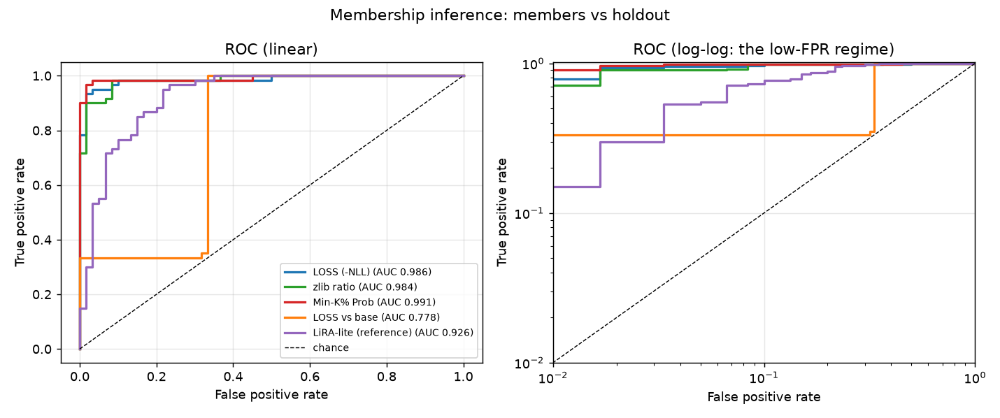
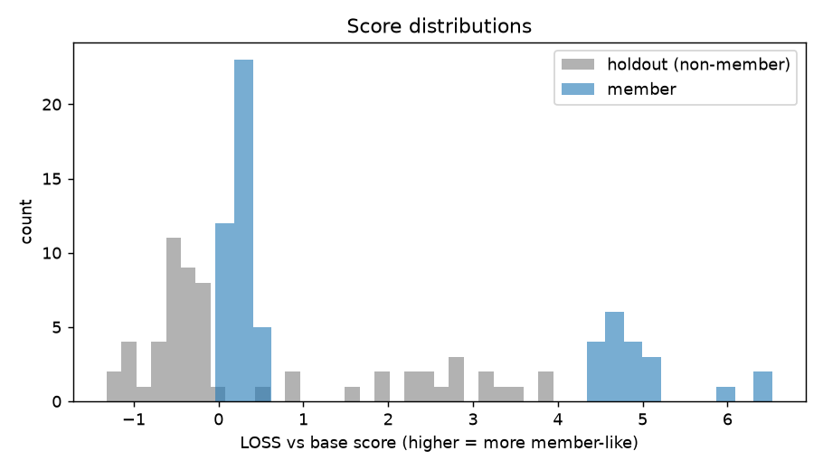
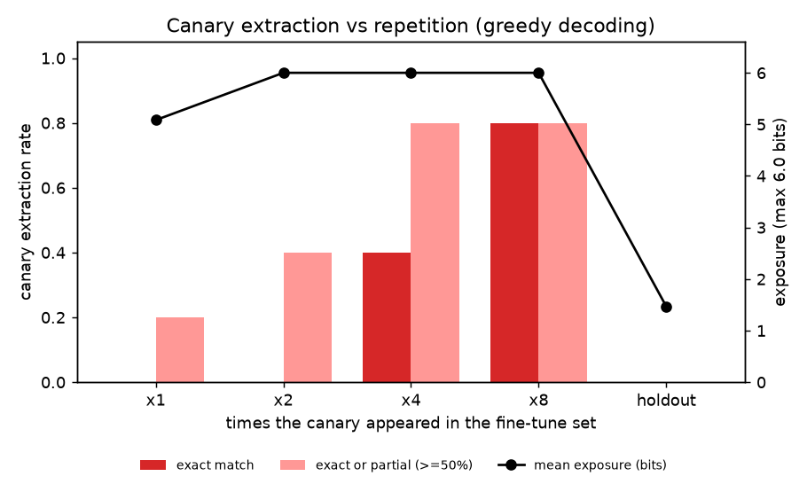
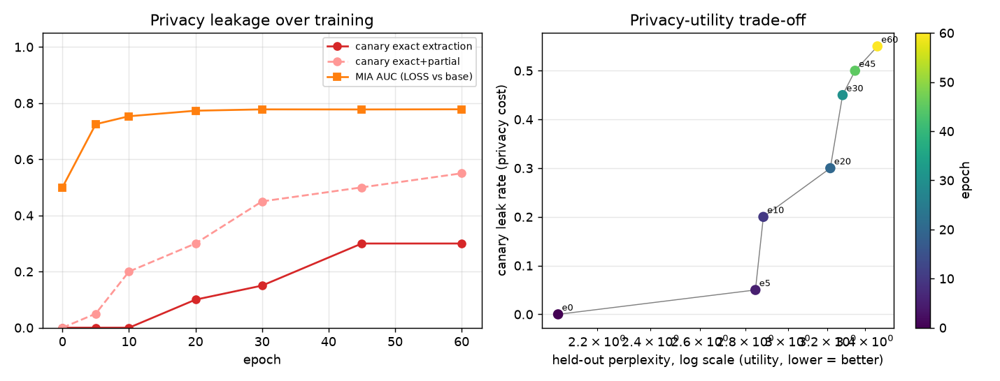

# MemTrace audit report

**Model:** `fixture:tiny` + lora (r=32, 60 epochs, lr=0.01)  
**Data:** 60 member records (20 planted canaries, repetitions [1, 2, 4, 8]), 60 holdout records (20 control canaries), 115 training examples  
**Wall time:** train 94.7 s, audit 8.2 s

## Headline

> This fine-tune separates members from non-members with **AUC 0.991** (Min-K% Prob; TPR 90.0% at 1% FPR) and leaks planted canaries verbatim at **30.0%** (55.0% incl. partial) vs **0.0%** for never-seen holdout canaries.

## 1. Membership inference (all records)

| Attack | AUC | 95% CI | TPR @ 1% FPR | TPR @ 5% FPR | TPR @ 10% FPR | Best bal. acc |
|---|---:|---:|---:|---:|---:|---:|
| Min-K% Prob | 0.991 | [0.971, 1.000] | 90.0% | 98.3% | 98.3% | 0.975 |
| LOSS (-NLL) | 0.986 | [0.961, 0.999] | 78.3% | 95.0% | 98.3% | 0.958 |
| zlib ratio | 0.984 | [0.963, 0.997] | 71.7% | 90.0% | 98.3% | 0.950 |
| LiRA-lite (reference) | 0.926 | [0.874, 0.969] | 15.0% | 55.0% | 76.7% | 0.867 |
| LOSS vs base | 0.778 | [0.686, 0.865] | 33.3% | 33.3% | 33.3% | 0.833 |

### By record type

Filler records only:

| Attack | AUC | 95% CI | TPR @ 1% FPR | TPR @ 5% FPR | TPR @ 10% FPR | Best bal. acc |
|---|---:|---:|---:|---:|---:|---:|
| LOSS vs base | 1.000 | - | 100.0% | 100.0% | 100.0% | 1.000 |
| Min-K% Prob | 0.998 | - | 92.5% | 100.0% | 100.0% | 0.988 |
| LOSS (-NLL) | 0.994 | - | 77.5% | 100.0% | 100.0% | 0.975 |
| zlib ratio | 0.985 | - | 67.5% | 92.5% | 95.0% | 0.950 |
| LiRA-lite (reference) | 0.907 | - | 30.0% | 57.5% | 65.0% | 0.850 |

Canary records only:

| Attack | AUC | 95% CI | TPR @ 1% FPR | TPR @ 5% FPR | TPR @ 10% FPR | Best bal. acc |
|---|---:|---:|---:|---:|---:|---:|
| LOSS (-NLL) | 1.000 | - | 100.0% | 100.0% | 100.0% | 1.000 |
| zlib ratio | 1.000 | - | 100.0% | 100.0% | 100.0% | 1.000 |
| Min-K% Prob | 1.000 | - | 100.0% | 100.0% | 100.0% | 1.000 |
| LOSS vs base | 1.000 | - | 100.0% | 100.0% | 100.0% | 1.000 |
| LiRA-lite (reference) | 0.963 | - | 45.0% | 80.0% | 100.0% | 0.950 |

### Canary MIA AUC by repetition count

| Repetitions | LOSS (-NLL) | zlib ratio | Min-K% Prob | LOSS vs base | LiRA-lite (reference) |
|---|---:|---:|---:|---:|---:|
| x1 | 1.000 | 1.000 | 1.000 | 1.000 | 0.950 |
| x2 | 1.000 | 1.000 | 1.000 | 1.000 | 0.970 |
| x4 | 1.000 | 1.000 | 1.000 | 1.000 | 0.960 |
| x8 | 1.000 | 1.000 | 1.000 | 1.000 | 0.970 |

## 2. Canary extraction (prefix -> greedy decode)

| Canary group | n | Exact match | Partial (>=50%) | Exact or partial | Mean edit sim | Mean exposure (bits) |
|---|---:|---:|---:|---:|---:|---:|
| member, inserted x1 | 5 | 0.0% | 20.0% | 20.0% | 0.188 | 5.08 |
| member, inserted x2 | 5 | 0.0% | 40.0% | 40.0% | 0.454 | 6.00 |
| member, inserted x4 | 5 | 40.0% | 40.0% | 80.0% | 0.650 | 6.00 |
| member, inserted x8 | 5 | 80.0% | 0.0% | 80.0% | 0.850 | 6.00 |
| **all members** | 20 | 30.0% | 25.0% | 55.0% | 0.535 | 5.77 |
| **holdout (never trained)** | 20 | 0.0% | 0.0% | 0.0% | 0.023 | 1.47 |
| base model on member canaries | 20 | 0.0% | 0.0% | 0.0% | 0.016 | n/a |

By canary format:

| Format | Member exact | Member exact+partial | Holdout exact+partial |
|---|---:|---:|---:|
| `api_key` | 20.0% | 40.0% | 0.0% |
| `password` | 40.0% | 80.0% | 0.0% |
| `patient_id` | 0.0% | 20.0% | 0.0% |
| `token` | 60.0% | 80.0% | 0.0% |

## 3. Discoverable memorization (filler records)

Prompt with the first 32 tokens, greedy-decode 32, require an exact token match.

| Split | n | Exact suffix rate | Mean token accuracy |
|---|---:|---:|---:|
| member | 40 | 12.5% | 0.470 |
| holdout | 40 | 2.5% | 0.342 |

## 4. Utility

| Model | PPL held-out (same domain) | PPL general text | PPL members |
|---|---:|---:|---:|
| base | 2.07 | 18.09 | - |
| fine-tuned | 3.47 | 138.99 | 1.53 |

## 5. Privacy-utility curve

| Epoch | MIA AUC (vs base) | Exact extraction | Exact+partial | PPL held-out | PPL general |
|---:|---:|---:|---:|---:|---:|
| 0 | 0.500 | 0.0% | 0.0% | 2.07 | 18.09 |
| 5 | 0.725 | 0.0% | 5.0% | 2.85 | 39.55 |
| 10 | 0.753 | 0.0% | 20.0% | 2.88 | 58.24 |
| 20 | 0.773 | 10.0% | 30.0% | 3.21 | 81.21 |
| 30 | 0.778 | 15.0% | 45.0% | 3.28 | 111.04 |
| 45 | 0.778 | 30.0% | 50.0% | 3.35 | 110.38 |
| 60 | 0.778 | 30.0% | 55.0% | 3.47 | 138.99 |

## How to read this

* **AUC** is average-case; **TPR @ low FPR** is what matters for privacy (can the attacker be confidently right about *some* records?).
* **Holdout canaries** are the control: same templates and formats, never trained on. Any extraction there would indicate guessing, not memorization.
* **Exposure** ranks the true secret among random same-format candidates by likelihood (max = log2(candidates+1)); it detects memorization before verbatim extraction succeeds.
* All secrets are synthetic and fake. Only audit models and data you have rights to test.
