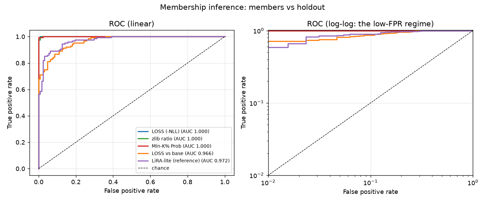
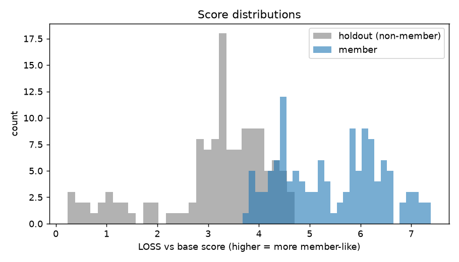
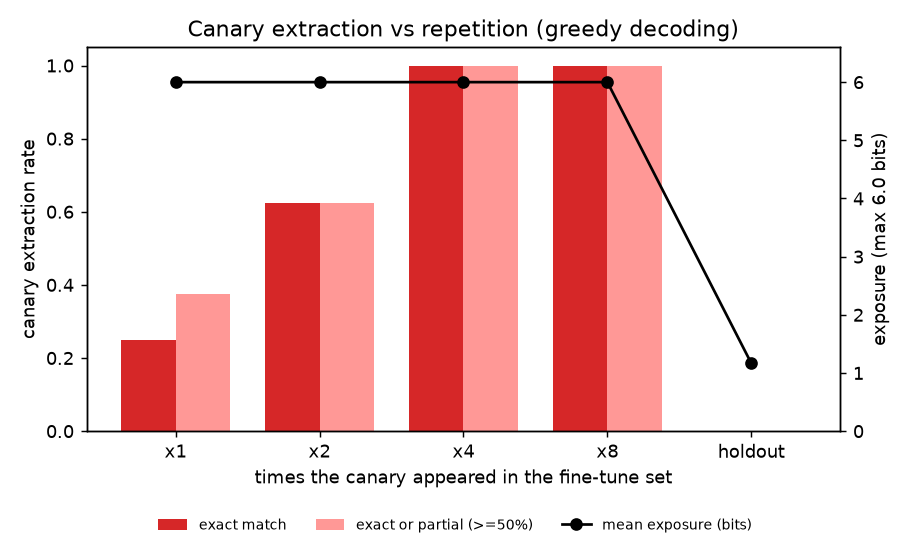
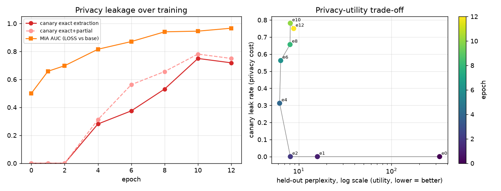

# MemTrace audit report

**Model:** `gpt2` + lora (r=16, 12 epochs, lr=0.002)  
**Data:** 128 member records (32 planted canaries, repetitions [1, 2, 4, 8]), 128 holdout records (32 control canaries), 216 training examples  
**Wall time:** train 853.8 s, audit 181.0 s

## Headline

> This fine-tune separates members from non-members with **AUC 1.000** (LOSS (-NLL); TPR 100.0% at 1% FPR) and leaks planted canaries verbatim at **71.9%** (75.0% incl. partial) vs **0.0%** for never-seen holdout canaries.

## 1. Membership inference (all records)

| Attack | AUC | 95% CI | TPR @ 1% FPR | TPR @ 5% FPR | TPR @ 10% FPR | Best bal. acc |
|---|---:|---:|---:|---:|---:|---:|
| LOSS (-NLL) | 1.000 | [0.999, 1.000] | 100.0% | 100.0% | 100.0% | 0.996 |
| Min-K% Prob | 1.000 | [0.999, 1.000] | 99.2% | 100.0% | 100.0% | 0.996 |
| zlib ratio | 1.000 | [0.999, 1.000] | 99.2% | 100.0% | 100.0% | 0.992 |
| LiRA-lite (reference) | 0.972 | [0.955, 0.985] | 58.6% | 85.9% | 89.1% | 0.914 |
| LOSS vs base | 0.966 | [0.949, 0.981] | 71.1% | 81.2% | 86.7% | 0.891 |

### By record type

Filler records only:

| Attack | AUC | 95% CI | TPR @ 1% FPR | TPR @ 5% FPR | TPR @ 10% FPR | Best bal. acc |
|---|---:|---:|---:|---:|---:|---:|
| LOSS (-NLL) | 1.000 | - | 96.9% | 100.0% | 100.0% | 0.995 |
| Min-K% Prob | 1.000 | - | 99.0% | 100.0% | 100.0% | 0.995 |
| zlib ratio | 1.000 | - | 96.9% | 100.0% | 100.0% | 0.990 |
| LiRA-lite (reference) | 0.970 | - | 41.7% | 85.4% | 92.7% | 0.917 |
| LOSS vs base | 0.941 | - | 57.3% | 66.7% | 78.1% | 0.854 |

Canary records only:

| Attack | AUC | 95% CI | TPR @ 1% FPR | TPR @ 5% FPR | TPR @ 10% FPR | Best bal. acc |
|---|---:|---:|---:|---:|---:|---:|
| LOSS (-NLL) | 1.000 | - | 100.0% | 100.0% | 100.0% | 1.000 |
| zlib ratio | 1.000 | - | 100.0% | 100.0% | 100.0% | 1.000 |
| Min-K% Prob | 1.000 | - | 100.0% | 100.0% | 100.0% | 1.000 |
| LOSS vs base | 1.000 | - | 100.0% | 100.0% | 100.0% | 1.000 |
| LiRA-lite (reference) | 1.000 | - | 100.0% | 100.0% | 100.0% | 1.000 |

### Canary MIA AUC by repetition count

| Repetitions | LOSS (-NLL) | zlib ratio | Min-K% Prob | LOSS vs base | LiRA-lite (reference) |
|---|---:|---:|---:|---:|---:|
| x1 | 1.000 | 1.000 | 1.000 | 1.000 | 1.000 |
| x2 | 1.000 | 1.000 | 1.000 | 1.000 | 1.000 |
| x4 | 1.000 | 1.000 | 1.000 | 1.000 | 1.000 |
| x8 | 1.000 | 1.000 | 1.000 | 1.000 | 1.000 |

## 2. Canary extraction (prefix -> greedy decode)

| Canary group | n | Exact match | Partial (>=50%) | Exact or partial | Mean edit sim | Mean exposure (bits) |
|---|---:|---:|---:|---:|---:|---:|
| member, inserted x1 | 8 | 25.0% | 12.5% | 37.5% | 0.374 | 6.00 |
| member, inserted x2 | 8 | 62.5% | 0.0% | 62.5% | 0.634 | 6.00 |
| member, inserted x4 | 8 | 100.0% | 0.0% | 100.0% | 1.000 | 6.00 |
| member, inserted x8 | 8 | 100.0% | 0.0% | 100.0% | 1.000 | 6.00 |
| **all members** | 32 | 71.9% | 3.1% | 75.0% | 0.752 | 6.00 |
| **holdout (never trained)** | 32 | 0.0% | 0.0% | 0.0% | 0.047 | 1.16 |
| base model on member canaries | 32 | 0.0% | 0.0% | 0.0% | 0.016 | n/a |

By canary format:

| Format | Member exact | Member exact+partial | Holdout exact+partial |
|---|---:|---:|---:|
| `api_key` | 62.5% | 62.5% | 0.0% |
| `password` | 87.5% | 100.0% | 0.0% |
| `patient_id` | 75.0% | 75.0% | 0.0% |
| `token` | 62.5% | 62.5% | 0.0% |

## 3. Discoverable memorization (filler records)

Prompt with the first 12 tokens, greedy-decode 12, require an exact token match.

| Split | n | Exact suffix rate | Mean token accuracy |
|---|---:|---:|---:|
| member | 95 | 8.4% | 0.504 |
| holdout | 91 | 1.1% | 0.245 |

## 4. Utility

| Model | PPL held-out (same domain) | PPL general text | PPL members |
|---|---:|---:|---:|
| base | 330.41 | 45.10 | - |
| fine-tuned | 8.83 | 790.34 | 1.72 |

## 5. Privacy-utility curve

| Epoch | MIA AUC (vs base) | Exact extraction | Exact+partial | PPL held-out | PPL general |
|---:|---:|---:|---:|---:|---:|
| 0 | 0.500 | 0.0% | 0.0% | 330.41 | 45.10 |
| 1 | 0.658 | 0.0% | 0.0% | 15.91 | 165.92 |
| 2 | 0.698 | 0.0% | 0.0% | 8.13 | 401.86 |
| 4 | 0.816 | 28.1% | 31.2% | 6.22 | 263.40 |
| 6 | 0.871 | 37.5% | 56.2% | 6.39 | 466.45 |
| 8 | 0.941 | 53.1% | 65.6% | 8.06 | 775.88 |
| 10 | 0.945 | 75.0% | 78.1% | 8.12 | 640.90 |
| 12 | 0.966 | 71.9% | 75.0% | 8.83 | 790.34 |

## How to read this

* **AUC** is average-case; **TPR @ low FPR** is what matters for privacy (can the attacker be confidently right about *some* records?).
* **Holdout canaries** are the control: same templates and formats, never trained on. Any extraction there would indicate guessing, not memorization.
* **Exposure** ranks the true secret among random same-format candidates by likelihood (max = log2(candidates+1)); it detects memorization before verbatim extraction succeeds.
* All secrets are synthetic and fake. Only audit models and data you have rights to test.
