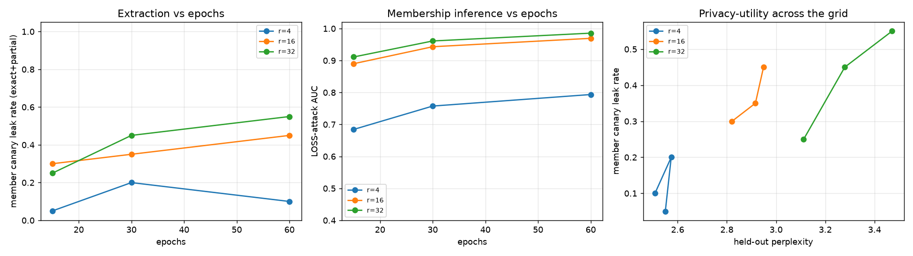
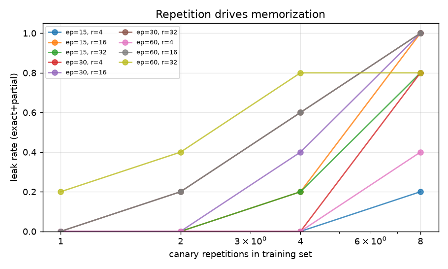

# Canary study: epochs x LoRA rank x repetitions (tiny fixture)

Command: `python experiments/run_canary_study.py --out results/sample/study`
(defaults: epochs 15/30/60, LoRA rank 4/16/32 with alpha = 2r, one shared pretrained fixture base,
20 member canaries inserted 1/2/4/8x and 20 holdout canaries). Wall time: about 4 min on CPU.

| Epochs | Rank | LOSS AUC | Min-K AUC | Member exact | Member exact+partial | Holdout exact+partial | Leak x1 | Leak x8 | Held-out PPL |
|---:|---:|---:|---:|---:|---:|---:|---:|---:|---:|
| 15 | 4 | 0.684 | 0.719 | 0% | 5% | 0% | 0% | 20% | 2.55 |
| 15 | 16 | 0.890 | 0.919 | 15% | 30% | 0% | 0% | 100% | 2.82 |
| 15 | 32 | 0.911 | 0.931 | 10% | 25% | 0% | 0% | 80% | 3.11 |
| 30 | 4 | 0.758 | 0.794 | 0% | 20% | 0% | 0% | 80% | 2.57 |
| 30 | 16 | 0.943 | 0.967 | 10% | 35% | 0% | 0% | 100% | 2.92 |
| 30 | 32 | 0.961 | 0.978 | 15% | 45% | 0% | 0% | 100% | 3.28 |
| 60 | 4 | 0.794 | 0.831 | 0% | 10% | 0% | 0% | 40% | 2.51 |
| 60 | 16 | 0.969 | 0.985 | 10% | 45% | 0% | 0% | 100% | 2.95 |
| 60 | 32 | 0.986 | 0.991 | 30% | 55% | 0% | 20% | 80% | 3.47 |

Takeaways (on this fixture):

* **Repetition dominates.** Canaries seen once almost never leak; canaries seen 8 times leak in 80-100 % of
  runs with rank >= 16.
* **LoRA rank is a privacy knob.** Rank 4 keeps MIA AUC below 0.8 and the best held-out perplexity;
  rank 16-32 memorizes far more, at *worse* held-out perplexity (overfitting).
* **Holdout canaries never leak** in any cell, so every leak above is memorization rather than guessing.

